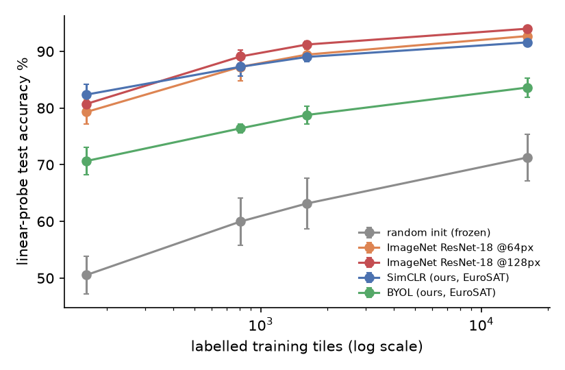
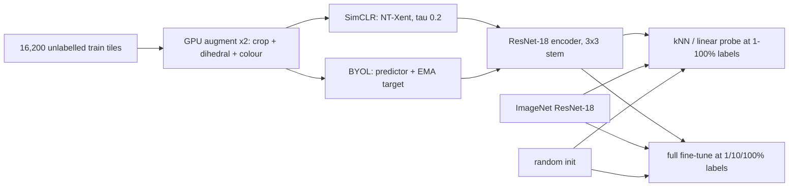
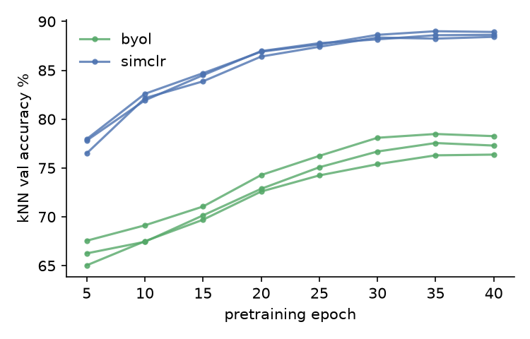
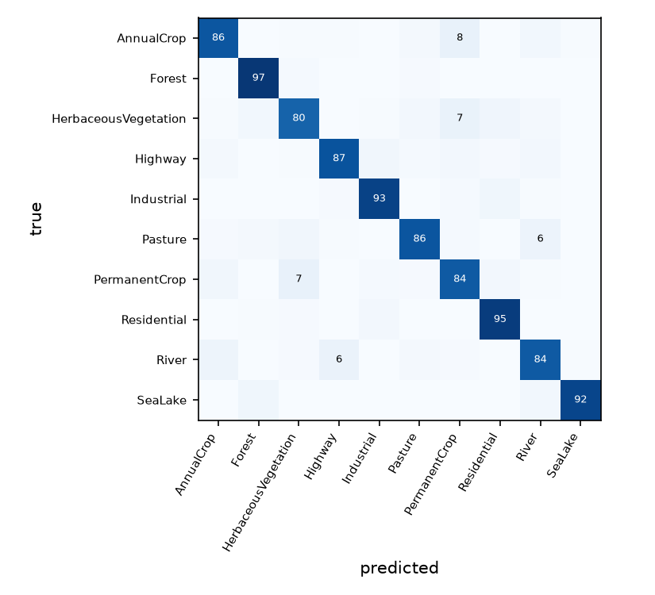

# landprobe

How much does self-supervised pretraining on unlabelled satellite tiles help when only a few hundred labels exist? This is a controlled study on EuroSAT. SimCLR and BYOL are pretrained from scratch on Apple silicon and compared with supervised training from scratch and with ImageNet transfer, at 1%, 5%, 10%, and 100% of the labels, with 3 seeds each.

[](https://github.com/eshaan2418/landprobe/actions/workflows/ci.yml)
[](LICENSE)


## Headline result

Test accuracy with 162 labels (1% of the training split). Values are mean ± 95% CI over 3 seeds.

| backbone | pretraining data / compute | linear probe | full fine-tune |
|---|---|---|---|
| random init / from scratch | none | 50.5 ± 3.4% | 73.7 ± 1.5% |
| **SimCLR (ours)** | 16,200 unlabelled EuroSAT tiles, 19 min on an M5 | **82.4 ± 1.9%** | 80.7 ± 0.5% |
| BYOL (ours) | same, 25 min | 70.7 ± 2.4% | 77.2 ± 2.2% |
| ImageNet ResNet-18 (128 px) | 1.28M labelled ImageNet images | 80.7 ± 1.3% | **88.5 ± 2.4%** |

Twenty minutes of in-domain SimCLR on 16k unlabelled tiles produces frozen features that beat ImageNet features at 1% labels (+1.6 ± 0.6 points, paired). With 5% or more labels, or with fine-tuning, ImageNet transfer wins at every label budget (by 2–8 points). Both kinds of pretraining beat training from scratch at every label budget, by up to +32 points for frozen features. BYOL was clearly undertrained at this budget.



## Demo

```
$ make demo      # fit a linear probe on 162 labels with frozen SimCLR features, classify 10 test tiles
linear probe fit on 162 labelled tiles in 0.2s

AnnualCrop/AnnualCrop_1441.jpg                AnnualCrop 0.97, PermanentCrop 0.03, HerbaceousVegetation 0.01
AnnualCrop/AnnualCrop_2852.jpg                PermanentCrop 0.76, AnnualCrop 0.12, Highway 0.11
HerbaceousVegetation/HerbaceousVegetation_2228.jpg Pasture 0.86, HerbaceousVegetation 0.10, PermanentCrop 0.04
Industrial/Industrial_771.jpg                 Industrial 0.94, River 0.02, Highway 0.02
River/River_1395.jpg                          River 1.00, Highway 0.00, AnnualCrop 0.00
...
```

Eight of the ten held-out tiles are correct. The two errors are the crop and vegetation confusions analysed below.

## Why this exists

Labelling land-use imagery needs trained annotators, while unlabelled Sentinel-2 tiles are free and endless. Self-supervised learning promises to turn the unlabelled data into a head start, but results are usually reported at ImageNet scale, with large GPU budgets and a single seed. This study asks the practical question at a budget a laptop can afford. With a few hundred labels and an afternoon of compute, should you pretrain on your own unlabelled data or reuse ImageNet weights? It also asks how that answer changes with the number of labels and the evaluation protocol.

## Highlights

- **Fully GPU-side augmentation:** random resized crop and all 8 dihedral symmetries (overhead imagery has no "up") as one batched `grid_sample`, plus vectorised colour jitter. Tests check exact symmetry and the HSV conversion against `colorsys`.
- **Controlled comparisons:** the same ResNet-18 body, the same label subsets (nested and stratified, seeds paired across methods), one fixed fine-tuning recipe for every backbone, and hyperparameters chosen on validation only (probe weight decay, ImageNet input size).
- **Three protocols:** weighted kNN, a linear probe (full-batch L-BFGS with L2 chosen on val), and full fine-tuning, at 1/5/10/100% labels.
- **The architecture choice was measured:** a pooled 3×3 stem trains at 1,204 img/s against 335 img/s unpooled, and `channels_last` is 2.5× slower on MPS.
- **Leakage controls:** no byte-identical images across splits. The remaining spatial-autocorrelation caveat is documented.

## Quick start

```bash
git clone https://github.com/eshaan2418/landprobe && cd landprobe
make setup     # uv venv (torch + torchvision with MPS)
make test      # augmentation, losses, EMA, splits, probes, CPU smoke pretrain/probe/fine-tune
make data      # EuroSAT RGB (MD5-checked) -> data/*.npy; splits/ are committed
make train     # 6 pretraining runs (SimCLR, BYOL x 3 seeds), ~2.2 h on an M5
make eval      # probes + 36 fine-tuning runs, ~1.6 h
make plots demo
```

## Method



SimCLR minimises NT-Xent over 2B views, with each image's other view as the positive. BYOL regresses an online predictor onto an EMA target network (τ from 0.99 to 1, cosine). Both use AdamW (lr 2e-3, wd 1e-4, warmup plus cosine) at batch 256 for 40 epochs. Details: [docs/DESIGN.md](docs/DESIGN.md).

## Results

Hardware: Apple M5 GPU (MPS), 48 GB. Software: PyTorch 2.14.1, torchvision 0.29.1. Data: EuroSAT RGB, stratified 60/20/20 split (16,200 / 5,400 / 5,400). All raw results are in `eval/results/{pretrain,probe,finetune,bench}/`, and tables are generated by `scripts/make_tables.py` into [eval/results/tables.md](eval/results/tables.md).

### Linear probe (frozen features), test accuracy %

| backbone | 1% (162) | 5% (810) | 10% (1,620) | 100% (16,200) |
|---|---|---|---|---|
| random init | 50.5 ± 3.4 | 60.0 ± 4.2 | 63.2 ± 4.5 | 71.3 ± 4.1 |
| ImageNet @64 px | 79.3 ± 2.1 | 87.3 ± 2.4 | 89.4 ± 1.0 | 92.7 ± 0.0 |
| ImageNet @128 px | 80.7 ± 1.3 | 89.1 ± 1.2 | 91.2 ± 0.6 | 94.0 ± 0.0 |
| SimCLR (ours) | 82.4 ± 1.9 | 87.3 ± 1.7 | 89.0 ± 0.8 | 91.6 ± 0.6 |
| BYOL (ours) | 70.7 ± 2.4 | 76.4 ± 0.8 | 78.8 ± 1.5 | 83.6 ± 1.7 |

Paired differences (same label subsets), SimCLR minus ImageNet @128 px: +1.6 ± 0.6 (1%), −1.8 ± 1.5 (5%), −2.2 ± 0.2 (10%), −2.4 ± 0.6 (100%). SimCLR minus random init: +31.8 / +27.3 / +25.9 / +20.3.

### Full fine-tuning, test accuracy %

Same recipe for every backbone: AdamW lr 1e-3, wd 0.05, batch 128, cosine schedule, 1,000 steps (2,000 at 100%). The ImageNet input size (128 px) was chosen on validation.

| backbone | 1% (162) | 10% (1,620) | 100% (16,200) |
|---|---|---|---|
| from scratch | 73.7 ± 1.5 | 88.1 ± 0.5 | 93.6 ± 0.8 |
| ImageNet @128 px | 88.5 ± 2.4 | 95.8 ± 0.6 | 97.8 ± 0.4 |
| SimCLR (ours) | 80.7 ± 0.5 | 92.5 ± 0.3 | 95.7 ± 0.5 |
| BYOL (ours) | 77.2 ± 2.2 | 90.4 ± 0.8 | 94.7 ± 1.0 |

SimCLR minus from scratch: +6.9 ± 1.0 / +4.4 ± 0.5 / +2.1 ± 0.5. SimCLR minus ImageNet: −7.8 ± 1.9 / −3.3 ± 0.8 / −2.1 ± 0.3.

### Pretraining

| run | wall min | peak MPS GB | kNN val % (end) |
|---|---|---|---|
| SimCLR × 3 seeds | 18.3–19.9 | 7.0–7.2 | 88.4–88.9 |
| BYOL × 3 seeds | 23.8–25.3 | 6.9–7.2 | 76.4–78.3 |



Compute used: 3.8 GPU-hours on the M5 (pretraining 2.2 h, fine-tuning 1.6 h, probes 2 min). CPU-only jobs from other experiments shared the machine during some pretraining runs, so wall-clock times are approximate.

## Error analysis



For the best 1%-label model (ImageNet, fine-tuned; test predictions summed over 3 seeds), the most frequent confusions are AnnualCrop → PermanentCrop (137), HerbaceousVegetation → PermanentCrop (123), PermanentCrop → HerbaceousVegetation (106), and River → Highway (95). The vegetation classes differ mainly in texture and seasonal colour, which a 64 px RGB tile at 10 m resolution barely resolves. Rivers and highways are both thin linear structures. Forest (97%) and Residential (95%) are easiest. The same pairs dominate the SimCLR demo errors.

- **Why BYOL lagged.** Its kNN accuracy climbed more slowly throughout (66% → 77% over 40 epochs, against SimCLR's 78% → 89%). Both curves flatten in the last epochs as the cosine learning rate decays, so BYOL did not converge to SimCLR's level within this schedule. BYOL is usually trained for hundreds of epochs. 40 epochs on 16k images is about 2.5k steps, roughly 1/40 of a standard ImageNet BYOL run. Read this as a budget effect, not evidence against BYOL in general.
- **Why ImageNet wins under fine-tuning but not frozen at 1%.** Frozen ImageNet features carry natural-image invariances that suit satellite tiles less well than in-domain SimCLR features, hence the probe win for SimCLR at 162 labels. Fine-tuning lets the larger and more diverse ImageNet representation adapt, and its starting point holds far more information (1.28M labelled images against 16k unlabelled tiles).

## Design decisions and trade-offs

- **Unequal pretraining data is the point.** The ImageNet baseline represents "reuse public weights". It used ~80× more images, labels, and far more compute than our 20-minute runs. The comparison answers a practical question, not a controlled-compute one.
- **The ImageNet baseline got a validation-chosen 128 px input** (it is better than 64 px on val at 10%). That costs 1.6× more fine-tuning time per step and is reported as such.
- **One fixed fine-tuning recipe** for all backbones, with no per-backbone tuning. Each method might gain from its own learning rate, ImageNet probably least.
- **AdamW at batch 256 instead of LARS at batch 4096,** the practical small-scale setting. That likely favours SimCLR, which tolerates small batches with enough negatives in a 512-view batch, over BYOL.

## Limitations, risks and ethical considerations

- **Spatial autocorrelation.** EuroSAT RGB has no geolocation, so the random split can put tiles from the same scene in train and test. Absolute accuracies are optimistic, though comparisons share the split. See [DATA_CARD.md](DATA_CARD.md).
- One dataset (European scenes), 64 px RGB only (no multispectral bands), one encoder size, and a short pretraining budget.
- Land-use classifiers can feed decisions about land, agriculture subsidies, or development. These models are research artefacts and should not be used for such decisions without local validation. See [MODEL_CARD.md](MODEL_CARD.md).

## Project structure

```
src/landprobe/
  data.py       download/MD5, decode, stratified splits, nested label subsets, duplicate check
  augment.py    batched GPU crop + dihedral + colour jitter
  models.py     ResNet-18 (3x3 stem), ImageNet ResNet-18, SimCLR, BYOL
  pretrain.py   self-supervised training loop with kNN monitoring
  evaluate.py   feature extraction, kNN, linear probe (L-BFGS), fine-tuning
  cli.py        `landprobe classify`
scripts/        prepare_data, pretrain, evaluate_all, bench_throughput, make_tables
splits/         train/val/test file lists (committed), leakage report
tests/          augmentation, losses, EMA, splits, probes, CPU smoke run on 60 real tiles
```

## Citations

- Helber, P. et al. *EuroSAT: A Novel Dataset and Deep Learning Benchmark for Land Use and Land Cover Classification.* IEEE JSTARS 12(7), 2019.
- Chen, T. et al. *A Simple Framework for Contrastive Learning of Visual Representations.* ICML 2020.
- Grill, J.-B. et al. *Bootstrap Your Own Latent: A New Approach to Self-Supervised Learning.* NeurIPS 2020.
- He, K. et al. *Deep Residual Learning for Image Recognition.* CVPR 2016.
- Wu, Z. et al. *Unsupervised Feature Learning via Non-Parametric Instance Discrimination.* CVPR 2018.
- Loshchilov, I. and Hutter, F. *Decoupled Weight Decay Regularization.* ICLR 2019.

## License

MIT. See [LICENSE](LICENSE).
